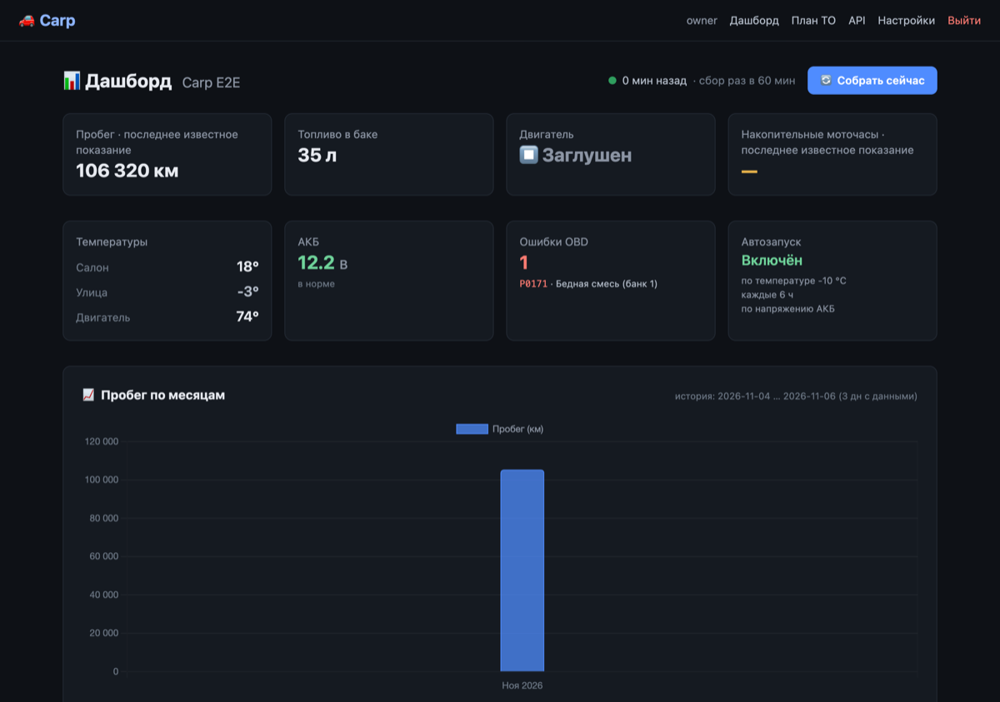

# Carp 🚗

Self-hosted car tracking on top of StarLine: mileage, fuel, engine hours, temperatures, battery
voltage and OBD error codes come from the CAN bus automatically. Plus maintenance planning on three
intervals and charts.

One installation serves one owner. Data stays on your server; the only outbound calls are to
StarLine and to a weather API for the outside temperature.



## Features

- **Hourly collection** — mileage, fuel, engine hours, GPS, battery voltage, cabin and engine temperatures.
- **Diagnostics** — OBD error codes with descriptions and history, remote-start settings (read-only).
- **Maintenance plan** — intervals by distance, calendar months and engine hours; "service due" on the dashboard.
- **Charts for the whole history** — daily aggregates are computed by the database, nothing is truncated.
- **Freshness indicator** — shows immediately when collection has fallen behind the interval.
- **Outside temperature** — resolved from the car's coordinates (Open-Meteo), since StarLine has none.
- **PWA** — installs to the Home Screen on iPhone and Android, opens without a browser bar.
- **Diagnostic console** — read-only StarLine API requests from the browser, no control commands.

## Stack

FastAPI · SQLAlchemy (async) · SQLite · Alembic · Jinja2 + Tailwind + HTMX + Alpine.js · Chart.js · APScheduler

## Quick start

```bash
git clone https://github.com/skymortem/Carp.git
cd Carp/backend

python3 -m venv .venv && source .venv/bin/activate
pip install -r requirements.txt

cp .env.example .env
python3 -c "import secrets; print(secrets.token_hex(32))"   # → SECRET_KEY in .env

PYTHONPATH="" uvicorn app.main:app --host 0.0.0.0 --port 8000
```

Open http://localhost:8000, register (this account becomes the owner; registration closes
afterwards) and go to `/setup` to connect StarLine.

**Exactly one Uvicorn process.** The scheduler and the StarLine session cache live inside the
process: with `--workers 2` you get double collection and races on the database.

## StarLine

You need `appId` and `secret` from my.starline.ru (the "Разработчикам" section is available only
with the Russian UI language). Carp handles the whole auth chain itself: app code → app token (4 h)
→ user token (1 year) → slnet cookie (24 h), then reads `/json/v3/device/{id}/data`.

Credentials are entered on `/setup` and stored in `backend/.env` with mode `0600`. Process
environment variables win over the file, so do not set `STARLINE_*` in systemd — `/setup` would
silently stop affecting collection.

## Operations

- **Schema** is migrated by Alembic on startup (`upgrade head`). A database created before
  migrations is stamped as `0001_baseline`, existing rows are untouched. New migration:
  `alembic revision --autogenerate -m "..."` from `backend`.
- **Backup** is one file, `carp.db`: `sqlite3 carp.db ".backup backup.db"`. A plain `cp` on a live
  database produces a torn copy.
- **Snapshots are never recalculated**: they hold what the alarm system reported at collection time.

## Tests

```bash
cd backend && pip install pytest pytest-asyncio
python -m pytest tests -q
```

Tests use a temporary SQLite database and a mocked StarLine API — real credentials and a real car
are not needed. The template JavaScript check requires Node.js and is skipped without it.

## Layout

```
backend/
├── alembic/            # schema migrations
├── app/
│   ├── main.py         # FastAPI, PWA manifest and service worker routes
│   ├── config.py       # settings from .env
│   ├── migrations.py   # upgrade head on startup
│   ├── models/         # User, Car, StarSnap, ServicePlan, ObdError, DeviceSettings
│   ├── services/       # starline, collection, scheduler, freshness, weather, maintenance
│   ├── routers/        # auth, dashboard, starline, service_plan
│   ├── templates/      # Jinja2
│   └── static/         # icons, manifest, sw.js, offline.html
└── tests/
```

## License

Apache License 2.0. Russian README — [README.md](README.md).
