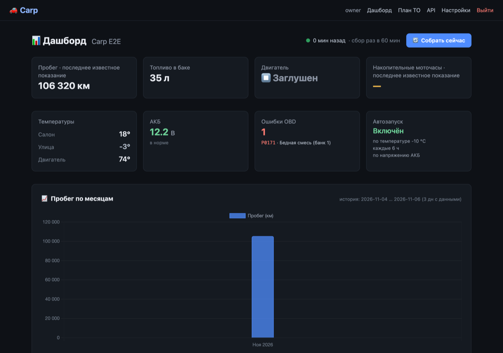

# Carp 🚗

Self-hosted учёт автомобиля по данным со StarLine: пробег, топливо, моточасы, температуры, АКБ
и ошибки OBD приходят с CAN-шины автоматически. Плюс план ТО по трём интервалам и графики.

Одна установка — один владелец. Данные лежат на вашем сервере, наружу уходят только запросы
к StarLine, температура воздуха и сообщения в Telegram (если подключён бот для заправок).



## Возможности

- **Автосбор раз в час** — пробег, топливо, моточасы, GPS, напряжение АКБ, температуры салона и двигателя.
- **Моточасы** — считаются по журналу событий StarLine («двигатель запущен/остановлен»), потому что
  `state.motohrs` у части устройств приходит пустым.
- **Заправки** — Carp замечает прирост уровня топлива, считает объём и спрашивает в Telegram цену
  литра; цена и стоимость сохраняются в базе.
- **Диагностика** — коды ошибок OBD с расшифровкой и историей, настройки автозапуска (только чтение).
- **План ТО** — интервалы по километрам, месяцам и моточасам; «ТО требуется» видно на дашборде.
- **Графики за всё время** — дневные агрегаты считает база, история не обрезается.
- **Индикатор свежести** — сразу видно, если сбор отстал от интервала.
- **Температура на улице** — по координатам машины (Open-Meteo), потому что в StarLine её нет.
- **PWA** — ставится на экран «Домой» на iPhone и Android, открывается без адресной строки.
- **Диагностическая консоль** — read-only запросы к StarLine API из браузера, без команд управления.

## Стек

FastAPI · SQLAlchemy (async) · SQLite · Alembic · Jinja2 + Tailwind + HTMX + Alpine.js · Chart.js · APScheduler

## Быстрый старт

```bash
git clone https://github.com/skymortem/Carp.git
cd Carp/backend

python3 -m venv .venv && source .venv/bin/activate
pip install -r requirements.txt

cp .env.example .env
python3 -c "import secrets; print(secrets.token_hex(32))"   # → SECRET_KEY в .env

PYTHONPATH="" uvicorn app.main:app --host 0.0.0.0 --port 8000
```

Откройте http://localhost:8000, зарегистрируйтесь (этот аккаунт станет владельцем, после него
регистрация закрывается) и перейдите в `/setup`, чтобы подключить StarLine.

**Ровно один процесс Uvicorn.** Планировщик и кеш сессии StarLine живут внутри процесса:
с `--workers 2` будет двойной сбор и гонки за базу.

## StarLine

Нужны `appId` и `secret` из личного кабинета my.starline.ru («Разработчикам», язык интерфейса —
русский). Carp проходит авторизацию сам: код приложения → токен приложения (4 ч) → токен
пользователя (1 год) → slnet-cookie (24 ч), после чего читает `/json/v3/device/{id}/data`.

Реквизиты вводятся на `/setup` и сохраняются в `backend/.env` с правами `0600`. Переменные
окружения процесса приоритетнее файла, поэтому не задавайте `STARLINE_*` в systemd — иначе
`/setup` перестанет влиять на сбор.

## Обслуживание

- **Схема БД** обновляется Alembic при старте (`upgrade head`). База, созданная до внедрения
  миграций, помечается как `0001_baseline` — данные не пересоздаются. Новая миграция:
  `alembic revision --autogenerate -m "..."` из каталога `backend`.
- **Бэкап** — один файл `carp.db`: `sqlite3 carp.db ".backup backup.db"`. Обычный `cp` на живой
  базе даёт битую копию.
- **Снимки не пересчитываются**: хранится то, что сигнализация отдала в момент сбора.

## Проверки

```bash
cd backend && pip install pytest pytest-asyncio
python -m pytest tests -q
```

Тесты используют временную SQLite и имитацию StarLine API — реальные учётные данные и машина
не нужны. Для проверки JavaScript шаблонов нужен Node.js; без него эта проверка пропускается.

## Структура

```
backend/
├── alembic/            # миграции схемы
├── app/
│   ├── main.py         # FastAPI, манифест и service worker PWA
│   ├── config.py       # настройки из .env
│   ├── migrations.py   # upgrade head при старте
│   ├── models/         # User, Car, StarSnap, ServicePlan, ObdError, DeviceSettings
│   ├── services/       # starline, collection, scheduler, freshness, weather, maintenance
│   ├── routers/        # auth, dashboard, starline, service_plan
│   ├── templates/      # Jinja2
│   └── static/         # иконки, manifest, sw.js, offline.html
└── tests/
```

## Лицензия

Apache License 2.0. Английская версия README — [README.en.md](README.en.md).
